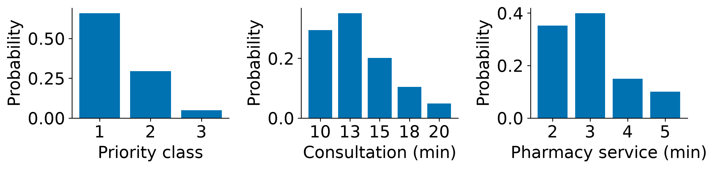
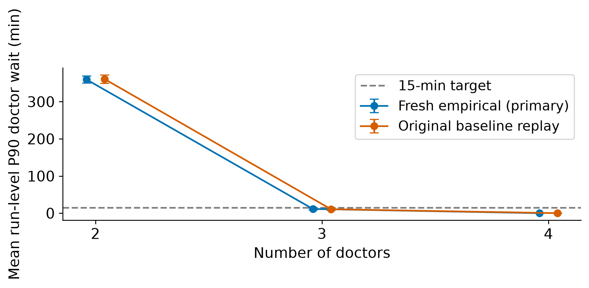

# Doctor Staffing Policy in a Hospital Outpatient Clinic

Lai Sin Hang (1155213900), Lee Ka Tung (1155212062)

## 1 System and decision problem

This study asks which staffing level among two, three and four doctors meets a 15-minute doctor-wait target at the lowest illustrative scheduled cost. Two doctors form the reference policy. The analysis concerns a synthetic outpatient clinic and does not estimate measured clinical outcomes [1,2].

Figure 1. Model boundary. Patients visit both stages once; pharmacy has one counter in the main comparison.

Patients share one doctor waiting system with three priority classes. Priority 3 is highest, followed by 2 and 1. Patients within a class follow first come, first served (FCFS). Consultations in progress are never interrupted. A patient then joins a pooled FCFS pharmacy queue immediately. This boundary retains the two queues affected by doctor staffing. Registration, travel, appointments, breaks, abandonment, rejection, clinical routing and pharmacy blocking are excluded.

Each run starts empty, admits exactly 200 patients, and ends after the last pharmacy departure. Arrivals can continue after the first 240 minutes, which define the peak period. No warm-up observations are removed because empty-start cohort performance is the intended outcome. Staff remain available until the system drains.

For each run, P90 is the linearly interpolated 90th percentile of all 200 doctor waits. The primary estimand is the expected run-level P90, estimated by averaging independent run P90 values. A point estimate at or below 15 minutes meets the illustrative target. We also require the upper endpoint of its two-sided 95% confidence interval to be at or below the target for confidence-supported feasibility.

The cost assumption is 100 units per doctor-hour for a common 18-hour scheduled horizon. This gives costs of 3,600, 5,400, 7,200 units. These assumptions are neither clinical standards nor recorded wages or shifts. Week 1 motivates a decision-focused boundary; Week 6 motivates fixed factors and explicit policy comparison [3,8].

## 2 Data and input analysis

The supplied archive contains 60,000 synthetic patient records, 14 fields and six scenarios. Each scenario contains 50 runs of 200 patients. Calibration uses the 10,000 records in Baseline_2Doc_240Peak. All scenarios are retained for independent replay checks. The audit found no missing fields, duplicate scenario/run/patient keys, negative waits, invalid priorities, nonpositive services, chronology errors or total-time identity errors. No records were removed [1].

Table 1. Input calibration. Full probability vectors, sample summaries and provenance are supplied in the reproducibility package.

| Input | Fitted distribution / parameter | Source / units |
| --- | --- | --- |
| Arrival gap | Peak previous-clock PMF on 3-7; late PMF on 3-7 | Synthetic baseline / min |
| Priority | 1: 0.6577 / 2: 0.2938 / 3: 0.0485 | Synthetic baseline / class |
| Consultation | 10/13/15/18/20; mean 13.38 | Synthetic baseline / min |
| Pharmacy | 2/3/4/5; mean 3.00 | Synthetic baseline / min |
| Poisson alternative | 0.23117 peak; 0.18286 late | Estimated / patients/min |

Figure 2. Empirical priority and service PMFs from the synthetic baseline (n=10,000).

Gaps are calculated within each run from time zero. A nonparametric renewal approximation selects a peak or late gap PMF using the previous arrival clock (<= 240 minutes versus later). A gap may cross the boundary. Peak arrivals total 2,774; their rate is count/(50 x 240). Late exposure totals 39,516 minutes, ending at each run's 200th arrival. Reduced late hourly counts partly reflect this fixed-cohort stopping rule, not hospital closure.

Mean consultation durations by priority range from 13.35 to 13.41 minutes. Descriptive service-period comparisons and rank correlations show limited differences in these records. Common service PMFs and independent input streams are therefore provisional simplifications; they do not prove independence. Empirical distributions retain the small discrete supports but cannot generate unobserved tails (Week 5 [7]).

The alternative is a continuous piecewise Poisson arrival process. It consumes exponential integrated hazard up to the peak boundary and the remainder at the late rate. It is used to examine structural input uncertainty. Source and simulated ECDF, gap and cohort-summary plots are included in the package. The Poisson model changes short-gap variability; it is not established as the true generator.

## 3 Discrete-event simulation model and implementation

The independent Python implementation uses a heap-based future-event list (FEL), a simulation clock, a priority waiting heap and idle doctor resources. FEL keys are time, event-type rank and insertion sequence. At the same timestamp, arrivals precede doctor completions. Simultaneous arrivals are batched before dispatch; the doctor queue key is (-priority, arrival time, patient ID). Event-type rank and clinical priority have different purposes [5,6].

On arrival, the patient joins the doctor heap; an idle doctor starts the highest eligible patient immediately. On consultation completion, the doctor is released and takes the next waiting patient. A service start records its time and schedules its completion. Service starts need no separate FEL entry. The doctor loop continues until the event list is empty.

Pharmacy uses a separate exact availability calendar because it cannot block or delay doctors. Consultation completions are ordered by (doctor end, patient ID), then assigned to the earliest available counter. Pharmacy start is the greater of consultation completion and counter availability. The model therefore does not claim an integrated pharmacy FEL. Every patient is followed to departure.

Pseudocode: initialize the empty state and FEL; pop the earliest event and advance the clock; update arrivals or doctor completions; dispatch eligible patients and schedule new completions; repeat until the FEL is empty; process the ordered pharmacy calendar and record every departure.

Table 2. Measured reconstruction errors across all 300 original runs.

| Replayed outcome | Records | Exact matches | Max error (min) |
| --- | --- | --- | --- |
| DocWaitTime | 60,000 | 60,000 | 0.00 |
| MedWaitTime | 60,000 | 60,000 | 0.00 |
| Total time | 60,000 | 60,000 | 0.00 |

The hand example gives doctor order A, C, D, B and departures 15, 22, 17, 19 minutes by patient A-D. Automated tests (31 passed in the recorded suite) cover priority, FCFS, non-preemption, event ties, multiple doctors/counters, empty and single-patient systems, invalid inputs and reproducibility. Every executed run also checks capacity, non-overlap, timestamp identities, queue discipline and waiting-area conservation.

Source records show 473,731 strict overtakes, including 473,731 higher-class overtakes and 0 same-class overtakes. This supports compatibility with the reconstructed priority rule. Exact input replay verifies implementation and source compatibility; neither test validates actual hospital behavior.

Doctor wait is start minus arrival; pharmacy wait is pharmacy start minus doctor end. Busy time is clipped to common windows [0,240] and [0,1080], then divided by resource-minutes. Queue area independently equals summed waiting intervals. Times use configurable 9-decimal minute resolution to preserve intended fractional event ties. Nominal peak load may exceed capacity; realized utilization never exceeds one.

## 4 Experiment design

The primary comparison uses 50 independent fresh empirical-input replications for each doctor count, with one pharmacy counter. A separate paired benchmark replays the 50 original baseline patient tables under each policy. Original scenario output values never become new experimental outcomes. Fifty runs were selected before execution as the specified minimum; confidence intervals show the resulting Monte Carlo precision.

NumPy SeedSequence(3410).spawn(R) creates replication seeds. Each replication spawns separate arrival, priority, consultation and pharmacy streams. Uniform draws are generated and saved before any staffing simulation. Inverse empirical CDFs transform these draws. The same immutable patient table is reused across doctor counts and pharmacy options within a condition. Input hashes match across all compared policies; independent replication tables differ.

For confirmation, a separate root seed 93410 generates 50 additional empirical runs per policy. All three policies are included, so confirmation does not select inputs after seeing a candidate. Sensitivities reuse the same underlying uniforms. Arrival or service transformations change patient tables as intended; CRN does not require unchanged transformed inputs across different input assumptions [8].

Table 3. Input-model diagnostics from generated base cohorts. Gap SD uses pooled within-run gaps, without crossing runs.

| Input model | Mean peak count | Mean last arrival (min) | Gap SD (min) |
| --- | --- | --- | --- |
| Source baseline | 55.48 | 1,030.32 | 1.30 |
| Empirical | 55.14 | 1,032.10 | 1.30 |
| Poisson | 53.94 | 1,031.79 | 5.14 |

For run KPI values Y(r), we estimate the mean, sample SD using R-1 degrees of freedom, and standard error SD/sqrt(R). The two-sided 95% interval is mean +/- t(0.975,R-1) x SE. Student-t is a finite-sample refinement of the approximate normal interval taught in Week 4. Patients within a run are not treated as independent replications. A zero-width interval records zero observed run variation, not certainty for every possible input.

Paired policy differences are new minus reference for doctor comparisons 3-2, 4-2 and 4-3. We verify matching replication IDs and input hashes, then form intervals from the run differences. The mean paired difference equals the difference of matched policy means. Negative waiting differences favor added doctors. These intervals describe conditional Monte Carlo uncertainty, not prediction intervals for patients or uncertainty about the synthetic calibration data.

We separately report pooled patient P90, the fraction of runs with run P90 at or below a target, and the mean patient fraction with wait at or below that target. Peak and priority subgroup P90s use their own cohorts; empty groups are missing with valid-run counts. These quantities answer different questions and do not imply a universal service guarantee.

## 5 Results and discussion

Table 4. Primary fresh empirical results (50 runs per policy). Waiting and total-time values are minutes; only the primary mean run P90 interval is shown here.

| Doctors | Mean run P90 [95% CI] | Mean doc wait | Pharmacy wait | Total time |
| --- | --- | --- | --- | --- |
| 2 | 359.82 [350.32, 369.32] | 175.50 | 0.37 | 192.27 |
| 3 | 11.33 [8.72, 13.93] | 3.06 | 0.68 | 20.15 |
| 4 | 0.00 [0.00, 0.00] | 0.06 | 0.74 | 17.21 |

Figure 3. Mean run-level P90 with 95% t intervals. Fresh empirical is primary; replay is a separate matched benchmark. All 200 patients define each run P90.

3 doctors is the lowest-cost confidence-supported primary candidate. Its paired P90 change versus two doctors is -348.49 minutes (95% CI -356.94 to -340.04), a 96.85% reduction in the mean. The original-input replay gives 10.60 minutes [8.33, 12.86] for this policy. Fresh confirmation gives 10.00 [8.00, 12.01]; its feasibility is evaluated separately in recommendation.csv.

For 3 doctors, 76% of runs met the 15-minute run P90 target, and the average patient service level was 93.94%. Pooled P90 was 9.00 minutes. Thus a supported mean target does not imply every run meets it. Mean subgroup run P90s were priority 1: 13.89; priority 2: 4.28; priority 3: 3.25 minutes. The peak value was 18.29, versus 4.85 for later arrivals. Mean priority-3 sample size was 10.14 patients per run.

Peak doctor utilization fell from 97.26% with two doctors to 94.60% with 3; peak pharmacy utilization was 61.03%. Mean pharmacy wait changed from 0.37 to 0.68 minutes. These measured effects explain the network trade-off without assuming congestion must move downstream.

Scheduled costs are 2 doctors: 3,600, 3 doctors: 5,400, 4 doctors: 7,200 units. For 3 doctors, 10% of runs had work after H; mean last arrival, consultation end and departure were 1032.10, 1046.34 and 1049.96 minutes. Mean doctor overtime workload was 0.56 busy minutes. This workload is not paid shift-clock overtime.

## 6 Sensitivity analysis

Each condition changes one factor at a time and uses 50 matched replications for all three doctor counts. Empirical scenarios include arrivals 10% faster/slower, consultation durations 10% longer/shorter, pharmacy durations 10% longer, and two pharmacy counters. Faster arrivals divide sampled gaps by 1.10 and recompute peak membership from the changed clock. The 200-person cohort remains fixed; this does not represent higher patient count in a fixed operating shift.

Table 5. Mean run P90 (min), 95% CI; *lowest-cost confidence-supported staffing at 15 min. All conditions and targets 10/20/30 appear in the package.

| Model / condition | 3 doctors P90 [CI] | 4 doctors P90 [CI] | Choice* |
| --- | --- | --- | --- |
| empirical / arrivals fast | 38.47
[33.58, 43.37] | 0.34
[0.18, 0.50] | 4 |
| empirical / base | 11.33
[8.72, 13.93] | 0.00
[0.00, 0.00] | 3 |
| empirical / doctor slow | 37.15
[32.13, 42.18] | 0.28
[0.13, 0.43] | 4 |
| poisson / arrivals fast | 70.09
[56.17, 84.00] | 11.28
[9.22, 13.33] | 4 |
| poisson / base | 40.48
[31.71, 49.26] | 6.91
[5.85, 7.97] | 4 |
| poisson / doctor slow | 72.82
[58.12, 87.52] | 11.86
[9.74, 13.97] | 4 |

The main empirical condition selects 3 doctors. Faster arrivals and longer consultations select four. The Poisson base condition selects 4, indicating sensitivity to arrival variability despite similar fitted mean rates. The second counter and slower pharmacy conditions retain the doctor-wait decision; downstream wait and total-time effects are available in sensitivity_summary.csv.

Targets of 10, 15, 20 and 30 minutes are evaluated from saved outputs without additional identical DES runs. Point feasibility and confidence-supported feasibility are reported separately. If an interval crosses a target, that cell remains inconclusive at the reported run count; this report does not assert a resolved threshold. The 3-by-2 staffing/consultation cells also provide paired difference-in-differences with confidence intervals in factorial_interaction.csv.

Changing a common positive doctor wage scales all scheduled costs and cannot reverse their ranking; wage_sensitivity.csv demonstrates this directly. A second pharmacy counter is a performance sensitivity only because no counter wage was supplied. Busy-time overtime proxies at premium factors 1.0, 1.5 and 2.0 are reported separately and are not real payroll. Arrival, service, staffing-hour and synthetic-data assumptions limit external application.

## 7 Recommendation and policy brief

Use 3 doctors as the provisional staffing policy when the calibrated empirical arrival pattern applies. Across 50 fresh matched replications, its mean run-level P90 doctor wait was 11.33 minutes (95% confidence interval 8.72 to 13.93), compared with 359.82 minutes for two doctors. The paired mean reduction was 348.49 minutes. Scheduled doctor cost rises from 3,600 to 5,400 illustrative units for the common 18-hour schedule. The policy met the 15-minute run P90 target in 76% of simulated runs; this is not a guarantee for every run. Retain capacity to review a fourth doctor if arrivals accelerate or consultations lengthen. The Poisson arrival alternative selected 4 doctors, so arrival variability materially affects the decision. Before implementation, collect actual arrival and service records, confirm queue rules and staffing hours, and repeat the analysis. The principal limitation is that all calibration records are synthetic. The confidence intervals measure simulation uncertainty conditional on fitted inputs and do not establish clinical validity or real payroll costs.

Policy brief: 160 words.

References

[1] Juneminazuki. Hospital Queue and Patient Flow Simulation. Kaggle. https://www.kaggle.com/datasets/juneminazuki/hospital-queue-and-patient-flow-simulation. Dataset title and URL supplied in the hospital proposal; generator documentation and license were not supplied.

[2] SEEM3410 Project Proposal: Doctor Staffing Policy in a Hospital Outpatient Clinic. Supplied SEEM3410_Project_Proposal (1).docx. Lai Sin Hang and Lee Ka Tung.

[3-8] W. Liu. SEEM3410 System Modeling and Simulation, 2026-27 Term 1. Supplied Week 1: From Real Systems to Models, Evaluation, and Simulation; Week 2: Analytical Queueing Formulas Versus Simulation Evaluation; Week 3: Discrete-Event Simulation Fundamentals; Week 4: Discrete-Event Simulation: Python Implementation and Output Analysis; Week 5: Input Distribution Calibration from Empirical Data; Week 6: Design of Simulation Experiments for System Improvement.

[9] SEEM3410 Team Project Guidelines, 2026-27 Term 1. Supplied three-page document.

AI assistance statement for team review: Codex assisted with implementation, test execution, experiment analysis, figures, presentation materials and report drafting. The team must verify the assumptions and results, understand the code, and confirm the course requirements for disclosure. The supplied guidelines do not specify an exact declaration form.

Reproducibility: the separate ZIP includes unchanged raw data, configuration, saved draws, scripts, tests, tables, figures, README and execution evidence. Run python run_all.py using the documented dependencies. Human tasks remain: approve synthetic inputs, confirm metric/cost assumptions and team details, proofread, submit before 1 December, and rehearse for the assigned 1 or 3 December presentation [9].
